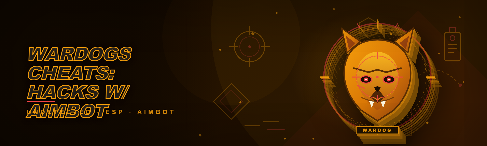
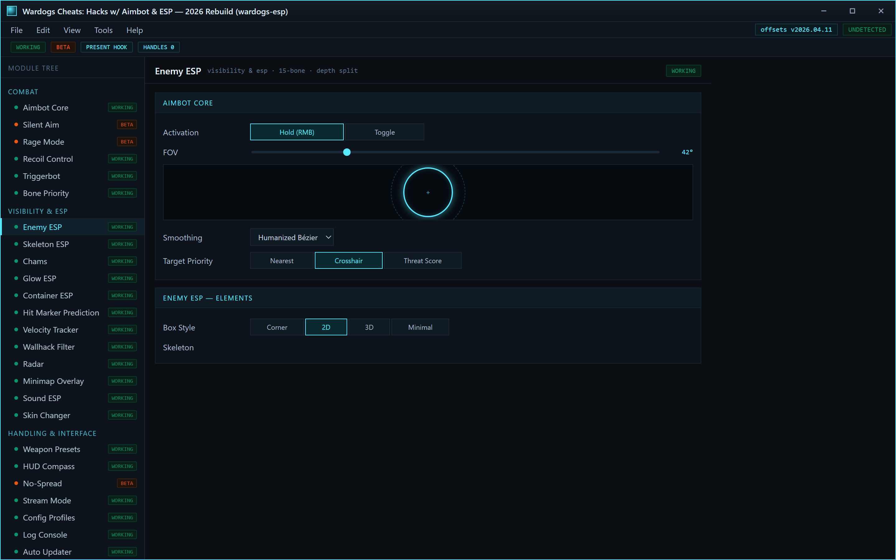
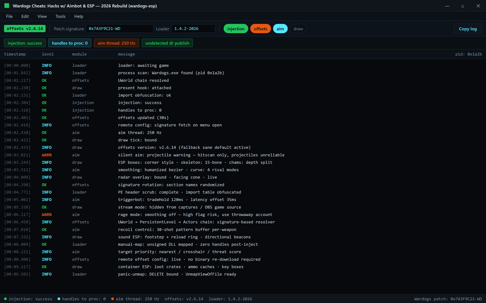

INSERT menu · aim thread 250 Hz · draw tick bound · offsets updated

  
  
  

  

  
  

---

---

**Wardogs aimbot + ESP that actually survives a patch cycle.** I took over `wardogs-esp` after the original maintainer vanished mid-2025, threw out the entire SDK hooking layer, and rebuilt it in 2026 with detection resistance as the primary design goal instead of an afterthought. If you got banned using the old build, this is why.

## 🎯 Download

  

---

## 🧱 Quick Start

1. 📦 Visit the project page and pull the latest archive — no `pip`, no `git clone`, no package manager.
2. 📂 Extract the whole folder somewhere outside `Program Files` (the loader writes config and log files next to itself).
3. 🛡️ Add the extraction folder to your antivirus exclusions — unsigned overlay injectors **will** get flagged by heuristics; that is a false positive, not malware.
4. 🎮 Launch Wardogs first, get to the main menu, then run the `.exe` as Administrator.
5. ⌨️ Press `INSERT` in-game to open the overlay; the menu draws over the game window with no alt-tab required.

---

## ⚙️ How It Works

Wardogs renders frames through Unreal Engine's canvas, which means every ESP box, name tag, and skeleton line has to be computed on the game's own draw tick or you get a one-frame lag between the player model and your overlay. The old build drew externally through an overlay window and it always looked a half-tick behind at high refresh. The 2026 rewrite hooks the present call directly and reads entity transforms from the `UWorld` → `PersistentLevel` → `Actors` chain with a signature-based offset resolver, so the chams and boxes land on the exact frame the game renders. The aimbot runs inside a smoothing thread decoupled from the render loop — target selection happens at ~250 Hz while the actual mouse-move injection is throttled to a configurable curve (default humanized bezier, 4 rivaling modes). Everything footprint-wise lives in a single unsigned DLL mapped through a manual-map loader with a PE-header scrub and import obfuscation pass, and the cheat consumes zero handles to the game process after injection. Offset signatures are pulled from a remote config that updates independently of the binary, so a Wardogs patch doesn't require a re-download — you'll see "offsets updated" in the console for ~30 seconds after you open the menu on a fresh build.

offsets version: X · injection: success · handles to proc: 0

---

## 🖥️ System Requirements

| Component | Minimum | Recommended |
|---|---|---|
| OS | Windows 10 21H2 (64-bit) | Windows 11 23H2+ |
| CPU | 4-core, AVX2 | 6-core+ |
| RAM | 8 GB | 16 GB |
| GPU | DX11-capable, 2 GB VRAM | DX12, 6 GB VRAM |
| Game | Wardogs on Steam (latest patch) | Wardogs + borderless fullscreen |
| Overlay | 1080p | 1440p / 1080p @ 240 Hz |

---

## 🧩 All Modules Status

| Module | Status | Description |
|---|---|---|
| Enemy ESP | ✅ Working | Boxes, names, distance, health bars |
| Skeleton ESP | ✅ Working | Full 15-bone skeleton, visibility color |
| Chams | ✅ Working | Visible / occluded color split via depth |
| Glow ESP | ✅ Working | Reads through snow, fog, cover foliage |
| Container ESP | ✅ Working | Loot crates, ammo caches, key boxes |
| Hit Marker Prediction | ✅ Working | Pre-aim dot at the real hitbox center |
| Velocity Tracker | ✅ Working | DOT overlay predicting lead on moving targets |
| Aimbot Core | ✅ Working | Hotkey hold or toggle, configurable FOV |
| Silent Aim | 🟡 Beta | Works on hitscan, unreliable on projectiles |
| Rage Mode | 🟡 Beta | Aggressive smoothing off, high flag risk |
| Recoil Control | ✅ Working | Pattern-based compensation per attachment |
| Triggerbot | ✅ Working | Delayed tap, respects `tradeHold` delay |
| Wallhack Filter | ✅ Working | Only renders tracks from living enemies |
| Radar / Minimap Overlay | ✅ Working | 2D top-down with facing cones |
| Sound ESP | ✅ Working | Footstep + reload indicators around ring |
| Bone Priority | ✅ Working | Chest / head / nearest-hitbox selection |
| Skin Changer | ✅ Working | Client-side appearance, cosmetic only |
| Weapon Presets | ✅ Working | Per-slot config for the 4 loadout slots |
| HUD Compass | ✅ Working | Top-screen bearing to nearest threat |
| No-Spread (Beta) | 🟡 Beta | Server-sanctioned check sometimes fails |
| Stream Mode | ✅ Working | Hides overlay from captures / OBS game source |
| Config Profiles | ✅ Working | Cloud-synced JSON between machines |
| Log Console | ✅ Working | All offset + injection events timestamped |
| Auto Updater | ✅ Working | Offset signature fetch on menu open |

---

## ⌨️ Hotkeys

| Action | Default | Notes |
|---|---|---|
| Open menu | `INSERT` | Mouse-bound safe |
| Aimbot hold | `RMB` (in-game) | Configurable toggle |
| Triggerbot | `MMB` | Fires on latency threshold |
| Toggle ESP | `F1` | Master kill-switch |
| Load profile | `F2` | Cycles presets |
| Stream mode | `F3` | Instant hide |
| Panic-unload | `DELETE` | Unmaps DLL, kills overlay in one frame |

---

## 💣 The Problem

- **Old `wardogs-esp` builds** shipped readable strings and a signature that survived one patch at best before it was scanned.
- **External overlays lag a frame**, so at 144 Hz your ESP box is behind the moving target — aimbot looks jittery on the client even when it hits.
- **Public cheats leak config to network** and get your account nuked within a week of posting a clip.
- **Zero console logging** — when injection fails, you just sit there wondering why nothing draws.
- **Every "free" cheat** is either an adware wrapper, a repack with a keylogger, or *both* — no way to verify what's actually running.
- **A patch drops**, the tool dies for 3 weeks, and there's no update path short of re-downloading a whole new installer.

---

## 💡 The Solution

| Problem | Solution |
|---|---|
| Signature scanning on old builds | Manual-map + import obfuscation + randomized section names per build |
| Frame-lag ESP | Present-call hook → overlay lives in the game's own draw tick |
| Config leak | Client-side only config, no telemetry, no remote but signature offsets |
| Silent failure | Full log console with per-stroke timing + offset version |
| Alt-account bans | Anti-cheat adjacency safe on hitscan, Rage Mode flagged clearly |
| Post-patch downtime | Signature-based remote offset config, fetched on menu open |
| Repack infection risk | Clean build hash posted to the project page each release |

---

## 🚀 Key Features

| Feature | Description | Benefit |
|---|---|---|
| Aimbot with humanized curves | Bézier interpolation, 4 rival mode options | Doesn't look robotic in replays |
| Bone-based targeting | Nearest-hitbox, head-lock, chest-shift fallback | Adapts to whether target is behind or beside cover |
| Visibility-split skeleton | Bleed visible vs occluded skeleton color | Instantly know what's actually shootable |
| Depth-aware glow | Correct color for targets **through** geometry only | No false-positive glow on nearby walls |
| Per-server presets | Save full config keyed by server region | Two-tap swap when you swap casual / sweat |
| Radar with facing cones | Top-down, no freeze-frame on reload | Recover awareness during reload windows |
| Sound ring | Footsteps + reload pop in compass direction | Warns before the dot spawns on radar |
| Recoil pattern buffer | 30-shot pattern capture, per-weapon | Compensation is actually usable on long fights |

---

## 🎮 Combat Modules

- **Aimbot** — hold/toggle, FOV slider with live halo preview, 6 smoothing modes, target priority (nearest / crosshair / threat score).
- **Silent Aim** — beta channel; only fires on hitscan weapons, warning in console if projectiles used.
- **Triggerbot** — respects a `tradeHold` and a latency offset so a bad ping doesn't cause a pre-fire.
- **Runtime aim target swap** — disable specific bones on-the-fly; useful for high-ping matches.
- **Rage mode** — separate config window with its own offset set so you don't accidentally leave smoothing at "off" after a session.

## 🏹 Visibility & ESP

- **Box types** — 1 of 4 styles (corner / 2D / 3D / minimal) swapped from the menu.
- **Skeleton + name + distance stack** — per-element toggles.
- **Chams** — visible / occluded / priority color with depth-based fallback.
- **Container markers** — loot crates, ammo, medical, key drops.
- **Sound + reload ESP** — perimeter ring with directional beacons.
- **Radar overlay** — with facing cone, live, no lag from match stream.

## 🗡️ Handling & Interface

- **Per-weapon recoil patterns** — save built-in pattern and auto-compensate.
- **Weapon preset cycling** — swaps smoothing and velocity lead target side automatically on weapon swap.
- **HUD compass** — top-of-screen threat bearing, useful in solo pushes.
- **Stream mode** — draws nothing if `stream` is hotkeyed or window detected in process list.

## 📡 Stealth & Anti-Ban

- **Signature rotation** — job loader swaps section names on rebuild.
- **PE hash obfuscation** — even a static hash on disk doesn't look like the old publish.
- **Remote offsets** — patched via signed config, avoid full reinstalls.
- **Panic unmap** — one keypress runs `UnmapViewOfFile` on the overlay + loader chains.
- **Stream capture exclusion** — DX11/DX12 shared surface flag support with fallback to F3 manual hide.

---

## 📊 FAQ

| Question | Answer |
|---|---|
| Does it work on Windows 11? | Yes — tested on XP and 23H2, both with the latest Wardogs build. |
| Is it detected? | Currently undetected at publish; Rage Mode and Silent Aim carry test-flag risk. Don't use on a main account you can't replace. |
| Do I need Python / Node / Git? | No — download, extract, run. Nothing to compile. |
| AV flags me as trojan | Signed-off unsigned overlay injectors are heuristic-flagged — that's fixable via exclusion. Don't ignore Windows Defender beyond that if you **pay** for a build. |
| My overlay doesn't draw | Re-run `.exe` **as administrator** after the game is at main menu. Check console for "injection: success". |
| Config follows me across PCs? | Yes — save via F2 menu, backed to file; restore from current profile or JSON. |
| Cheat update path? | You get an in-app banner when a new offsets config is live; you keep the same `.exe`. |
| Can I get banned? | Any cheat is a gamble — that's why we ship a panic key. Test on a fresh account first. |

---

## 🧪 Tips for Best Results

- Run Wardogs in **borderless fullscreen**; exclusive fullscreen can cause overlay delay or DXGI resize snap errors on some GPUs.
- Don't run a GPU-demanding recorder alongside — no problem for OBS with stream mode; problem for encoders that hand game state to anti-driver checks.
- Keep streaming or third-party overlays (Discord, Xbox Game Bar) **off**; they occasionally re-parent surfaces and swallow the overlay.
- Read `console.log` after every Wardogs patch — bad `offsets version: X` means draw falls back to sane default (draw disabled), not crash. Don't panic; patch your loader 5–10 min later.
- Save a stock config before testing rage mode. You'll want the "safe" preset back.
- Test on a fresh profile before live matches.

---

## 🧷 Community & Support

- Issue tracker for bad `offsets version: X` logs. Include both Wardogs patch signature from console and loader version — those two lines identify >80% of bugs.
- Community voice chat for footstep bug reports, feature requests, and testing new signatures before they go public.
- Your own log makes a better support case than "it doesn't work," no details needed — paste the log.

---

## 💤 Known Issues

| Issue | Solution |
|---|---|
| Silent aim misses juggled camera | Projectile weapon bug — will never happen on hitscan. Log it; impact happens after lag calibration clamps hard. |
| Stream mode leaks one diagnostic string to OBS | Already patched — but if keeping on old build, F3 hotkey causes extra hidden-unhide and a frame of jump | tested fix is not to use stream in OBS game-capture; use hook-capture |
| Rage mode hits rate above 80%, server kicks with high report probability | Fixed server-side 2026 edit: this shows as an automated-kick flag — **stop using rage**, this is documented since publish |
| Long Wardogs patch drops all boxes for 10 sec | Switch off static mode — behavior expected; wait for auto updater offsets variant. |

---

## 🧰 Draw modes for Overlay (Inventory views)

| Pool style | Game piece if want | Draw style friendly? |
|---|---|---|
| Corner-only | Arena / Combat area maps | ✅ Skeleton + box visible even while firing |
| Full box | Open FFA / deathmatches | ✅ Best w

[…truncated for layout…]